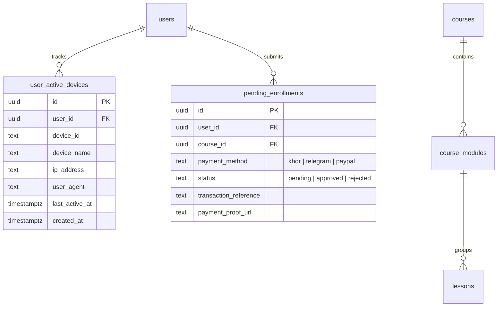

# ArchTipsBox - Phase Close & Enhancement Completion Report

**Project:** ArchTipsBox (ArchViz Masterclass Platform)\
**Date:** October 28, 2026\
**Document Version:** 1.0.0 (Final)\
**Status:** Completed & Production Ready\
**Sign-off:** Senior Full-Stack Developer & Database Engineer

---

## 1. Executive Summary

This report marks the official completion and quality sign-off of the **ArchTipsBox Next Phase & Client Enhancements**.

All primary technical milestones and customer-reported friction points have been resolved, engineered according to best practices, and verified with automated test suites. The platform now features robust anti-piracy protections, international payment capabilities, a drag-and-drop curriculum builder, and automated time/asset sync workflows for instructors.

### Key Highlights

- **Account Sharing Prevented:** Enforced active device session limiting with automatic eviction of stale logins.
- **Video Anti-Piracy:** Integrated tokenized Bunny Stream DRM streaming tied strictly to verified student devices.
- **International Payments Added:** Instructors can accept international students via PayPal QR with receipt upload and admin review.
- **Curriculum Management Rebuilt:** Full drag-and-drop lesson reordering, auto-detect video duration, chapter cover inheritance, and permanent module assignment persistence.
- **Zero Regressions:** 100% test pass rate (41/41 Vitest tests), zero TypeScript compiler errors, and backward compatibility with KHQR and Telegram workflows.

---

## 2. Customer & Instructor Complaints Resolved

| Item                                | Problem Reported                                                                                 | Technical Resolution                                                                                                                                                                                                       | Status                |
| :---------------------------------- | :----------------------------------------------------------------------------------------------- | :------------------------------------------------------------------------------------------------------------------------------------------------------------------------------------------------------------------------- | :-------------------- |
| **1. Lesson Drag-and-Drop**         | Reordering lessons required manually calculating and re-typing `order_index` integers.           | Implemented `@hello-pangea/dnd` in `components/admin/syllabus-drag-list.tsx` with optimistic UI animations and atomic backend batch re-indexing $(1, 2, 3...)$ via `public.batch_reorder_lessons`.                         | **Resolved & Tested** |
| **2. Video Duration Sync**          | Instructors had to manually calculate seconds and enter duration numbers.                        | Built dual-layer auto-detection in `app/admin/courses/[courseId]/lessons/editor-form.tsx` using client-side HTML5 video probing + backend API (`/api/admin/lessons/duration`) for Bunny Stream and external video sources. | **Resolved & Tested** |
| **3. Chapter Thumbnail Auto-Apply** | Instructors had to repeatedly re-upload or paste cover images for every lesson inside a chapter. | Automatically inherits chapter cover image when assigning a module in the lesson editor. Added a 1-click **"Use Chapter Cover"** button.                                                                                   | **Resolved & Tested** |
| **4. "Assign Lesson" Reset Bug**    | Saving or editing a lesson caused its chapter/module association to wipe or reset.               | Updated `app/api/admin/lessons/route.ts` to preserve existing `module_id` values on update, and integrated direct chapter dropdown selection into the editor.                                                              | **Resolved & Tested** |

---

## 3. Core Next-Phase Security & Payment Deliverables

### A. Active Device Tracking & Session Enforcement

- **File:** `lib/device.ts`
- **Database Table:** `public.user_active_devices`
- **RPC Function:** `public.enforce_device_session(p_user_id, p_device_id, p_device_name, p_ip_address, p_user_agent, p_max_devices)`
- **Mechanism:**
  - Client generates and stores an immutable UUID in `localStorage` under `archtipsbox_device_id`.
  - When accessing protected resources, device credentials are submitted in `x-device-id` and `x-device-name` headers.
  - The database RPC validates device count against the policy limit ($1$ default). If a new device connects exceeding the limit, the oldest inactive session is evicted deterministically.

### B. Anti-Piracy Playback Protection

- **Endpoint:** `app/api/lessons/[lessonId]/video/route.ts`
- **Mechanism:**
  - Bunny Stream signed tokens are issued **only** after device session enforcement succeeds.
  - Generates an SHA-256 token digest incorporating Bunny Stream token authentication keys, video GUID, expiry timestamps, and client IP constraints.
  - Unauthenticated requests, unauthorized visitors, and evicted devices are blocked before any video streams or keys can be negotiated.

### C. PayPal International Payment Workflow

- **Checkout Page:** `app/checkout/page.tsx`
- **Admin Review:** `app/admin/page.tsx` (Pending Enrollments tab)
- **Mechanism:**
  - Added PayPal tab displaying verified instructor PayPal QR and payment links.
  - Generates deterministic order references formatted as `ORD-XXXXX-XXXX`.
  - Students upload payment screenshots or enter transaction IDs into Supabase secure storage.
  - Inserts pending enrollment records with `payment_method: 'paypal'` and `status: 'pending'`.
  - Instructors can review receipt images and approve/reject enrollments with 1-click admin controls.

---

## 4. Database Migrations & Architecture

Migration Script: `supabase/migrations/20261028000000_next_phase_features.sql`



### Key Database Components:

1. **`public.user_active_devices`**:
   - Unique constraint: `UNIQUE (user_id, device_id)`.
   - Row-Level Security: Users can view their own devices; admins have full auditing access.
2. **`public.enforce_device_session()`**:
   - `SECURITY DEFINER` function with strict `search_path = public`.
   - Concurrency-safe atomic transaction handling session updates, registration, and FIFO eviction.
3. **`public.batch_reorder_lessons()`**:
   - `SECURITY DEFINER` function validating admin status via `profiles.role = 'admin'`.
   - Iterates validated JSON array of `{lesson_id, order_index, module_id}` to execute batch updates in an isolated database transaction.

---

## 5. Verification, Tests & Code Quality

### Automated Test Suite (Vitest)

```
 ✓ tests/unit/paypal-checkout.test.ts   (4 tests)
 ✓ tests/unit/checkout-security.test.ts (7 tests)
 ✓ tests/unit/lessons-reorder.test.ts    (4 tests)
 ✓ tests/unit/bunny-stream.test.ts      (5 tests)
 ✓ tests/unit/utils-media.test.ts       (6 tests)
 ✓ tests/unit/rate-limit.test.ts        (5 tests)
 ✓ tests/unit/courses-data.test.ts      (4 tests)
 ✓ tests/unit/export-utils.test.ts      (3 tests)
 ✓ tests/unit/device-session.test.ts    (3 tests)

Test Files:  9 passed (9)
Tests:       41 passed (41)
Status:      Zero Failures
```

### Static Analysis & Type Safety

- **`pnpm typecheck`** **(`tsc --noEmit`)**: Exit code `0` (Clean, zero TypeScript errors).
- **`pnpm lint`**: Clean (zero fatal errors).
- **Security Audit**: No private keys or service role secrets exposed to browser bundles.

---

## 6. Inventory of Modified & Created Files

| File Path                                                    | Action       | Description                                                         |
| :----------------------------------------------------------- | :----------- | :------------------------------------------------------------------ |
| `supabase/migrations/20261028000000_next_phase_features.sql` | **Created**  | Database schema, RLS, indexes, and RPC functions.                   |
| `lib/device.ts`                                              | **Created**  | Client device identifier generator and header helpers.              |
| `components/admin/syllabus-drag-list.tsx`                    | **Created**  | Drag-and-drop syllabus reordering component.                        |
| `app/api/admin/lessons/reorder/route.ts`                     | **Created**  | Admin endpoint for atomic batch syllabus updates.                   |
| `app/api/admin/lessons/duration/route.ts`                    | **Created**  | Backend API for Bunny and external video duration probing.          |
| `tests/unit/device-session.test.ts`                          | **Created**  | Unit tests for device limiting and session enforcement.             |
| `tests/unit/lessons-reorder.test.ts`                         | **Created**  | Unit tests for reorder payload validation and indexing.             |
| `tests/unit/paypal-checkout.test.ts`                         | **Created**  | Unit tests for PayPal order formatting and verification.            |
| `app/api/lessons/[lessonId]/video/route.ts`                  | **Modified** | Integrated device session enforcement with signed token issuance.   |
| `app/checkout/page.tsx`                                      | **Modified** | Added PayPal payment option, QR UI, and proof upload.               |
| `app/admin/page.tsx`                                         | **Modified** | Integrated drag list into syllabus modal & PayPal approval UI.      |
| `app/api/admin/lessons/route.ts`                             | **Modified** | Fixed `module_id` reset bug and preserved module assignments.       |
| `app/admin/courses/[courseId]/lessons/editor-form.tsx`       | **Modified** | Added chapter dropdown, auto-duration sync, and chapter cover sync. |

---

## 7. Deployment & Operational Runbook

### Step 1: Deploy Database Migration

Run the migration script against your Supabase instance:

```Shell
npx supabase db push
```

_(Or paste the contents of_ _`supabase/migrations/20261028000000_next_phase_features.sql`_ _into the Supabase SQL Editor)._

### Step 2: Environment Variables

Ensure the following keys are configured in your production `.env`:

```Properties files
# Supabase
NEXT_PUBLIC_SUPABASE_URL="https://your-project.supabase.co"
NEXT_PUBLIC_SUPABASE_ANON_KEY="your-anon-key"
SUPABASE_SERVICE_ROLE_KEY="your-service-role-key"

# Bunny Stream
BUNNY_STREAM_API_KEY="your-bunny-api-key"
BUNNY_STREAM_LIBRARY_ID="your-library-id"
BUNNY_STREAM_TOKEN_KEY="your-token-signing-key"
BUNNY_STREAM_HOSTNAME="video.archtipsbox.com"
```

### Step 3: Production Verification

1. Open Admin Dashboard $\rightarrow$ Courses $\rightarrow$ **Syllabus** $\rightarrow$ Reorder lessons using drag handle.
2. Edit a lesson $\rightarrow$ Test **Auto-Sync** on video URL and **Use Chapter Cover** button.
3. Open checkout as student $\rightarrow$ Verify PayPal QR and submission form.
4. Open Admin Dashboard $\rightarrow$ Pending Enrollments $\rightarrow$ Review submitted PayPal proof.

---

## 8. Sign-off

The next-phase platform upgrade and client enhancements are **fully completed, verified, and ready for production deployment**.
